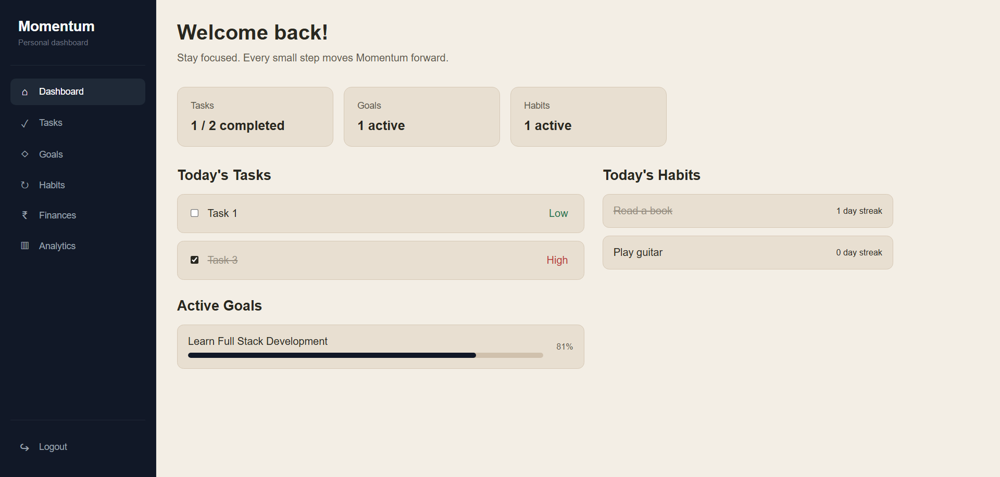
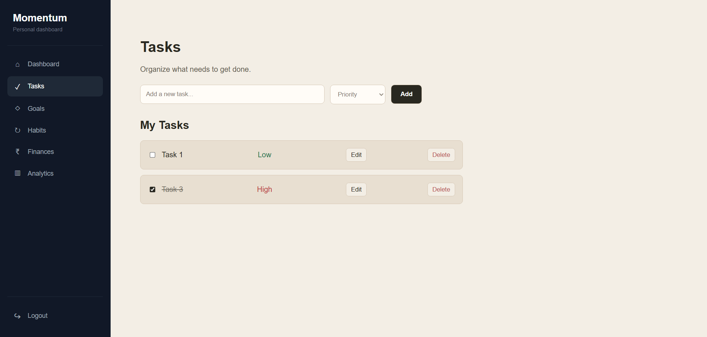
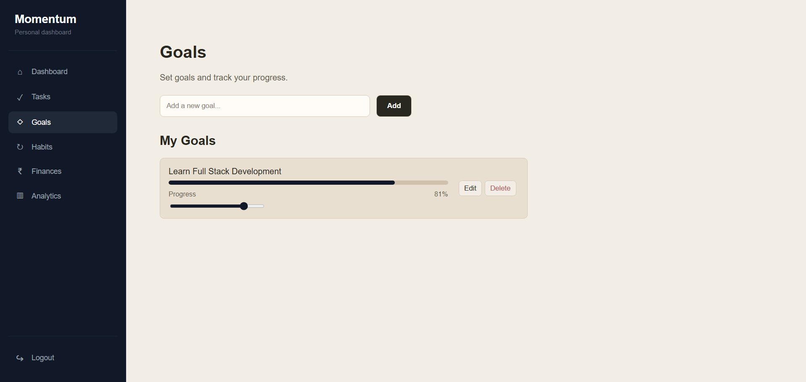
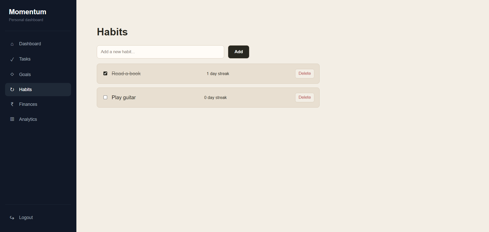
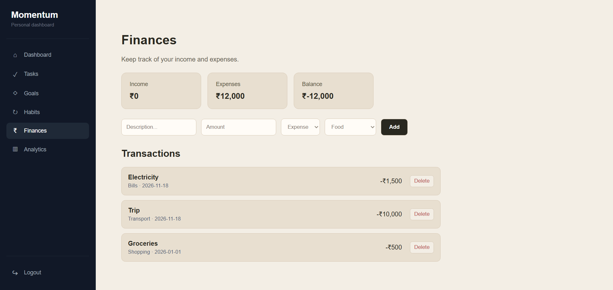
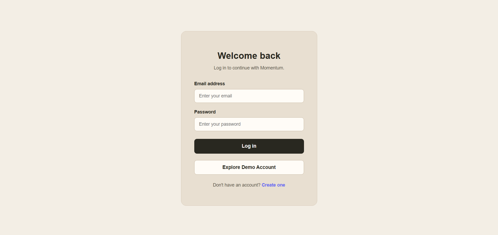

# Momentum — Personal Productivity Dashboard

Momentum is a full-stack personal productivity dashboard built to help users organize their daily activities, track personal goals, build consistent habits, and manage their finances in one place.

The project started as a React application and was expanded into a full-stack application using Node.js, Express, and MongoDB. It includes user authentication, protected routes, persistent data storage, and an interactive demo account.

## 🌐 Live Demo

**[Explore Momentum](https://momentum-woad-kappa.vercel.app/)**

Visitors can explore the application using the **Explore Demo Account** option on the login page without creating an account.

The demo account includes sample tasks, goals, habits, and transactions. It is shared among demo visitors and automatically restored from a saved snapshot daily.

> **Demo availability:** The backend runs on Render's free tier and may sleep after inactivity. The first request after a period of inactivity can take longer while the server wakes up.

## 📸 Application Preview

### Dashboard


### Task Management


### Goals Tracking


### Habit Tracking


### Finance Management


### Login and Demo Access



## ✨ Features

### 📋 Task Management
- Create, edit, complete, and delete tasks.
- Organize tasks using priority levels.
- Track completed and pending tasks.

### 🎯 Goal Tracking
- Create and manage personal goals.
- Update goal progress.
- Monitor goal completion.

### 🔄 Habit Tracking
- Create and manage daily habits.
- Mark habits as completed.
- Track habit streaks.

### 💰 Finance Management
- Record income and expenses.
- Categorize transactions.
- Monitor income, expenses, and balance.

### 🔐 Authentication & Security
- User registration and login.
- Email verification.
- Secure password hashing using bcrypt.
- JWT-based authentication.
- HTTP-only authentication cookies.
- Protected API routes and user-specific data access.

### 👀 Interactive Demo Account
- Explore the application without registering.
- Access pre-populated sample data.
- Add, edit, and delete demo records.
- Automatically restore demo data from a saved MongoDB snapshot.
- Track the last reset date to prevent duplicate daily resets.

### 📱 Responsive Interface
- Responsive dashboard layout.
- Dedicated sections for tasks, goals, habits, finances, and analytics.
- Clean interface with a light workspace and dark sidebar.

## 🛠️ Tech Stack

| Category | Technologies |
|---|---|
| Frontend | React, JavaScript, CSS |
| Build Tool | Vite |
| Backend | Node.js, Express.js |
| Database | MongoDB Atlas |
| ODM | Mongoose |
| Authentication | JWT, bcrypt |
| Email Service | Resend |
| Deployment | Vercel, Render |

## 🏗️ Project Architecture

Momentum follows a client-server architecture.

```text
Momentum/
│
├── src/
│   ├── components/
│   ├── pages/
│   ├── context/
│   ├── config/
│   └── ...
│
├── server/
│   ├── config/
│   ├── controllers/
│   ├── middleware/
│   ├── models/
│   ├── routes/
│   ├── scripts/
│   ├── utils/
│   └── server.js
│
├── public/
├── package.json
└── README.md
```

**Frontend:** React handles the user interface and communicates with the backend through API requests.

**Backend:** Express provides REST API endpoints, handles authentication, validates requests, and performs database operations.

**Database:** MongoDB Atlas stores user accounts and application data.

## ⚙️ Running Locally

### Prerequisites

- Node.js and npm
- MongoDB Atlas account or local MongoDB instance
- Resend API key (required for email verification functionality)

### 1. Clone the repository

```bash
git clone https://github.com/Anujchhaparwal/momentum.git
cd momentum
```

### 2. Install frontend dependencies

```bash
npm install
```

### 3. Install backend dependencies

```bash
cd server
npm install
```

### 4. Configure environment variables

Create a `.env` file inside the `server` directory.

```env
PORT=5000
NODE_ENV=development

MONGO_URI=your_mongodb_connection_string

JWT_SECRET=your_jwt_secret
JWT_EXPIRES_IN=your_token_expiry

FRONTEND_URL=http://localhost:5173

RESEND_API_KEY=your_resend_api_key
```

Replace the placeholder values with your own configuration. Never commit environment files or expose API keys and secrets.

### 5. Start the backend

From the `server` directory:

```bash
npm run dev
```

### 6. Start the frontend

Open another terminal, navigate to the project root, and run:

```bash
npm run dev
```

Open the local URL provided by Vite, usually:

```text
http://localhost:5173
```

## 🔄 Demo Account Reset

The demo account uses a saved MongoDB snapshot to restore its original sample data.

The reset scheduler:
- Checks the time using the `Asia/Kolkata` timezone.
- Schedules the daily reset for 5:30 AM IST.
- Checks periodically while the backend is running.
- Performs a missed reset when the backend starts after the scheduled time.
- Uses MongoDB transactions to keep the reset and reset-date update consistent.

**Note:** Because the production backend uses Render's free tier, the reset may happen later than 5:30 AM if the service is asleep at the scheduled time.

## 🚀 Deployment

| Component | Platform |
|---|---|
| Frontend | Vercel |
| Backend | Render |
| Database | MongoDB Atlas |

The frontend communicates with the deployed backend through the `/api/v1` API route.

## 🔮 Future Improvements

- Improve dashboard analytics and visualizations.
- Add more productivity insights.
- Enhance mobile usability.
- Explore additional habit and goal tracking features.
- Improve backend availability and scheduled background processing.

## 👨‍💻 Author

**Anuj Chhaparwal**

- GitHub: [Anujchhaparwal](https://github.com/Anujchhaparwal)
- Project Repository: [Momentum](https://github.com/Anujchhaparwal/momentum)
- Live Application: [Momentum Dashboard](https://momentum-woad-kappa.vercel.app/)

---

Built as a hands-on full-stack development project to practice React, REST APIs, authentication, database integration, and deployment.
